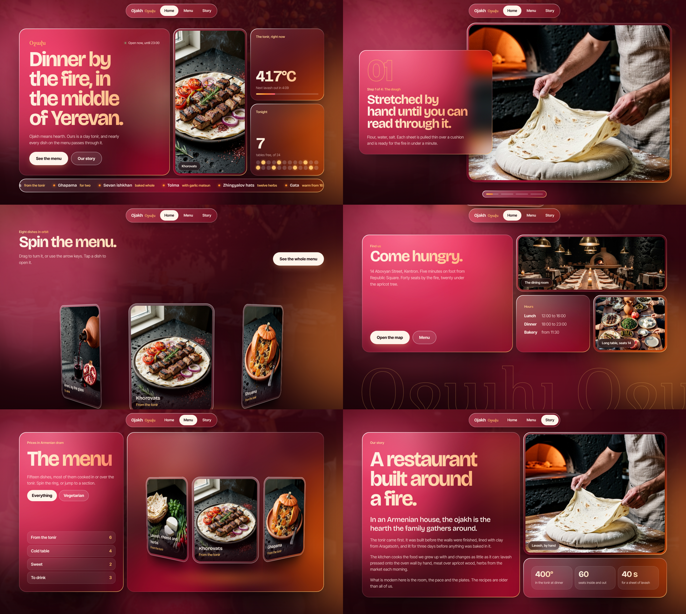

# Ojakh

A concept website for a made-up modern Armenian restaurant in Yerevan, built around a tonir oven. Designed and built by [Numinae](https://t.me/numinaestudio) as a portfolio piece.

**Live site:** https://numinae.github.io/ojakh-restaurant/

## What's in it

- **Liquid glass interface:** frosted panels with bevelled edges float over the restaurant's photography and catch a light that follows the cursor.
- **Live-looking tiles:** oven temperature, a countdown to the next lavash, free tables, and open or closed based on Yerevan time.
- **Scroll story:** four pinned scenes, from dough to fire to table to glass.
- **3D menu:** a ring of dishes you can drag to spin; tap one to open it.
- **Page transitions:** a different one for each page (glass slats, a liquid drop, a melt).
- **Menu page:** fifteen dishes with a vegetarian filter and section links.

Three pages (Home, Menu, Story), plain HTML, CSS and JavaScript, no frameworks or build step. Fonts are self-hosted. All photos were generated on a local GPU with Flux 2.
